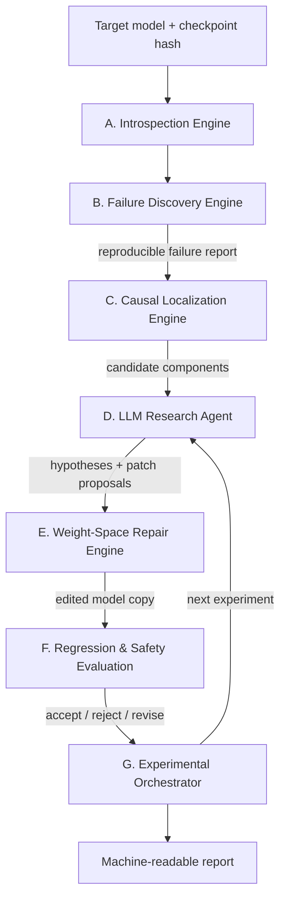

# MAJJATANTU — Shalyachikitsak

**Autonomous neural-network debugging, causal interpretability and weight-space repair.**

> *Majja-tantu* ≈ "nerve-fibre" · *Shalyachikitsak* ≈ "surgeon". A surgeon for the fibres inside a neural network.

**Status:** Research & development — Phase I scaffolding started. No empirical repair results yet; the package layout, introspection toolkit, direction-ablation operator, and evaluation harness are in place. See [`CHANGELOG.md`](CHANGELOG.md) for what landed.
**Fields:** Deep learning · Mechanistic interpretability · Weight-space programming · Autonomous agents · Model editing · Causal inference

---

## TL;DR

MAJJATANTU is a planned research framework in which an AI agent **finds why a neural network misbehaves, makes a tiny edit to its weights (no retraining), and proves the edit helped without breaking anything else.** It is the controlled-experiment follow-up to the "Weight-Space Programming" paper (MIT CSAIL, Nov 2026), and it explicitly tests whether the LLM adds value over simple non-LLM baselines.

---

## Table of contents

1. [What this project is](#1-what-this-project-is)
2. [The research it builds on](#2-the-research-it-builds-on)
3. [What the paper actually showed](#3-what-the-paper-actually-showed)
4. [How MAJJATANTU interprets and extends it](#4-how-majjatantu-interprets-and-extends-it)
5. [Core research questions](#5-core-research-questions)
6. [Architecture](#6-architecture)
7. [End-to-end workflow](#7-end-to-end-workflow)
8. [Mathematical formulation](#8-mathematical-formulation)
9. [Benchmarking and evaluation design](#9-benchmarking-and-evaluation-design)
10. [Major research challenges](#10-major-research-challenges)
11. [Technical stack](#11-technical-stack)
12. [Repository structure](#12-repository-structure)
13. [Roadmap](#13-roadmap)
14. [Limitations and honest caveats](#14-limitations-and-honest-caveats)
15. [Notes for AI collaborators](#15-notes-for-ai-collaborators)
16. [References](#16-references)
17. [License and contact](#17-license-and-contact)

---

## 1. What this project is

Modern networks hold millions or billions of parameters, yet when one misbehaves the usual fixes are fine-tuning, retraining, architecture changes or prompt engineering. MAJJATANTU explores a different route: build an autonomous research system that

1. inspects a model's internals,
2. diagnoses a reproducible failure,
3. finds the components causally responsible,
4. makes a **small, targeted edit to the weights** (no gradient-based retraining), and
5. proves, with held-out evaluation, that the edit helped without breaking anything else.

The long-term goal is an AI system that can systematically debug and repair other AI systems. This is exploratory work. **A failed repair is a valid result**, and mapping *when direct weight editing does not work* is an explicit research objective.

## 2. The research it builds on

The main reference is **"Sparks of Weight-Space Programming: LLMs can natively read & write neural network weights"** by Rikiya Takehi, Jayden Teoh, Alex Zhang and Omar Khattab (MIT CSAIL), published 2 November 2026 as a research blog post.

Its central idea, **Weight-Space Programming**: a general-purpose LLM reads and writes a network's weights directly, not through an optimizer and not with gradient descent, guided by a natural-language goal. The authors used GPT-6 Astra and release full logs of every experiment.

Related prior work this project also draws on: ROME and MEMIT (targeted factual edits in transformers), activation patching / causal tracing, steering vectors and direction ablation ("abliteration"), and Elhage et al.'s circuit analysis of induction (copying) heads.

> **Source status.** The paper is a blog post with released logs, not a peer-reviewed publication. Treat its numbers as strong early evidence, not settled fact. See [§14](#14-limitations-and-honest-caveats).

## 3. What the paper actually showed

Eight experiments, grouped by whether the LLM **reads**, **fixes** or **writes** weights.

| # | Task | Setup (short) | Reported result |
|---|------|---------------|-----------------|
| 1 | Read: which game was this network trained on? | 4 PPO policies, same MLP (17,253 weights), weights as text, no tools | Named the right game for all four |
| 2 | Read: what does this diffusion model generate? | 3 tiny DDPMs (23,824 weights), no tools, no forward passes | Identified circle / square / triangle from output-layer geometry (drew outlines, not filled shapes) |
| 3 | Read: what did this language model learn, from middle layers only? | 3 character-level transformers (7.2M params), input/output layers removed, Python allowed but no running the network | Correct language in all runs; found exactly the true induction (copying) heads |
| 4 | Fix: car-on-ramp policy stuck in a local minimum | One reply, no tools, edits 3.5% of 171,664 weights | Success in 1,024 / 1,024 episodes (was 0) |
| 5 | Write from scratch: three MinAtar games | Weights written as text in one reply, no data, no gradients, no rollouts | Beat PPO at 100M steps in all three; Breakout 517.4 vs 25.3 for PPO at 500M; Seaquest and Asterix below or near PPO at 500M |
| 6 | Write from scratch: 9×9 Go, 1.48M weights | Python sandbox, 0–50 forward passes | 0 passes: wins more than half vs small PPO nets. 50 passes: beats an equal-size PPO net trained on 20M games |
| 7 | Read: which of two Gemma 3 270M models is sycophantic? | Weights only | **Failed.** Succeeded in 3/3 pairs once it could see attention patterns on texts it wrote itself |
| 8 | Fix: make Qwen3.5-0.8B better at math | Python kernel over weights, 10 / 25 / 50 forward passes, no gradients | At 50 passes: MATH-500 7.9% → 48.1%, GSM8K 13.8% → 67.1%, IFEval 21.0% → 62.3%, edit = 131,072 weights (≈0.016%) |

**Experiment 8 in detail** is the most relevant to this project. The base model mostly got stuck in repetitive reasoning loops (93% of MATH-500 answers hit the 32,768-token limit). Astra traced the looping to one direction written by the MLPs of layers 15 and 19, and subtracted that direction from 64 output columns in each. At 10 and 25 forward passes the loops barely went away; at 50 the token-limit rate fell to 33%.

**The negative result that matters most:** on Gemma 3 270M, which rarely loops, Astra could not improve math. Its failures were ordinary reasoning errors with no single component to switch off, and no edit moved MATH-500 by more than about a point. The authors' own reading: editing weights can **remove an obstacle that hid an ability, but cannot add an ability the model lacks.**

## 4. How MAJJATANTU interprets and extends it

The paper demonstrates *that* an LLM can do weight-space repair when handed a harness. MAJJATANTU asks the engineering and scientific questions that come next.

| Observation in the paper | What MAJJATANTU does with it |
|--------------------------|------------------------------|
| Exp. 8 follows a pipeline: observe failure (loops) → localize (a direction in layer 15/19 MLP outputs) → edit (subtract it) → validate on held-out benchmarks | Make this pipeline **explicit, modular and automated** (subsystems A–G below) instead of a one-off LLM session |
| Quality depended heavily on the **forward-pass budget** (10 and 25 passes gave little; 50 gave a large gain) | Treat the forward-pass budget as a first-class, logged, comparable resource across all methods |
| Weights alone were not enough to diagnose *behavior* in Exp. 7; attention patterns on self-written probes were | Give the agent **activation- and attention-level tools**, not just raw tensors. This is why the introspection and causal engines exist |
| The edit was made inside a Python kernel, not by pasting billions of numbers into a prompt | The agent talks to the model through **structured tools** (summaries, slices, spectra, interventions) |
| Gemma 3 270M could not be improved | Build a **repair-feasibility predictor** (research question 8): when is a failure an "obstacle" (editable) vs. a "missing capability" (not)? |
| A skeptical analysis argues Exp. 8 resembles a standard steering / direction-ablation recipe a human could run | Include a **non-LLM baseline** (activation-difference direction ablation) so any LLM advantage is measured, not assumed |
| Edits were judged on benchmarks Astra never saw | Keep final test data **inaccessible to the agent** and report regressions, not just wins |

In short: MAJJATANTU is the **controlled-experiment version** of Weight-Space Programming. It asks whether the LLM reasoning actually adds value over simpler methods, whether the repairs generalize, whether they damage anything else, and where the approach stops working.

## 5. Core research questions

> **Can an autonomous AI agent diagnose and repair neural-network failures through sparse, causally informed weight modifications while preserving the model's existing capabilities?**

1. Can a failure mechanism be identified through activation analysis and causal interventions?
2. Can an LLM reason about weight matrices and propose meaningful parameter modifications?
3. Can repairs be made without gradient descent or conventional fine-tuning?
4. How few parameters must change to correct a specific failure?
5. Does a repair generalize to unseen inputs?
6. Can the system tell a real repair from an edit that overfits its evaluation examples?
7. Can repair strategies transfer between independently trained models and architectures?
8. Can the system predict when direct weight editing is unlikely to succeed?

The hard part is not generating new numbers. It is knowing **which parameters should change, why, and what else will move with them.**

## 6. Architecture

Seven subsystems, wired into a closed loop.



### A. Neural Network Introspection Engine
Inspect structure and behaviour: extract weight tensors; inspect attention heads and feed-forward layers; capture intermediate activations; analyze parameter distributions; SVD and spectral analysis; compare internal states on successful vs. failed predictions. It must work without keeping all activations in memory at once.

### B. Automated Failure Discovery Engine
Find **reproducible** behavioural failures before anything is edited. Initial categories: repetitive reasoning loops (the paper's Exp. 8 failure, measurable as token-limit hits), incorrect factual associations, arithmetic and symbolic errors, instruction-following inconsistencies, sensitivity to irrelevant prompt changes, and deliberately injected parameter corruption (for ground truth). A failure must reproduce across repeated runs to be eligible for repair.

### C. Causal Circuit Localization Engine
Find components that contribute to the failure: activation patching, causal tracing, attention-head ablation, neuron and feature interventions, layer-wise sensitivity, counterfactual activation replacement, sparse feature analysis, causal mediation.
*A localized activation is not automatically a localized weight defect.* The system must test whether editing the associated parameters actually fixes the behaviour.

### D. LLM-Powered Research Agent
Reads failure reports and statistics, forms hypotheses, chooses causal experiments, interprets results, proposes patches, decides whether more evidence is needed, and recommends accept / reject / revise. It works through **structured tool interfaces**, never raw billion-parameter dumps. Its explanations are hypotheses, not proof.

### E. Weight-Space Repair Engine
The central experimental component. Candidate operators: sparse updates, low-rank interventions, projection / direction removal, targeted attention-matrix edits, feed-forward weight edits, constrained numerical search, LLM-generated tensor transformations, causal-feature-informed editing.
The primary mode **prohibits gradient-based training during repair.** The agent may use forward passes, causal interventions, matrix operations and black-box feedback under a fixed budget. Gradient methods (LoRA, fine-tuning) appear only as comparison baselines.

### F. Regression and Safety Evaluation Engine
Every patch is validated on: target repair success, generalization to unseen prompts, retention of unrelated capabilities, robustness across decoding settings, modification sparsity, compute cost, stability across repeats, and persistence after save / reload. A patch that fixes one example but damages unrelated skills does **not** count as success.

### G. Autonomous Experimental Orchestrator
Manages budgets, tracks hypotheses and observations, versions every model modification, runs regression tests automatically, compares competing strategies, **rolls back** failures, and emits machine-readable experiment reports. It must support unattended runs inside explicit compute and safety limits.

## 7. End-to-end workflow

1. **Model selection.** Load an open-weight model; record architecture, config, tokenizer and checkpoint hash.
2. **Behavioural evaluation.** Evaluate the unmodified model on a fixed task suite.
3. **Failure identification.** Isolate a reproducible failure; write a structured diagnostic report.
4. **Internal investigation.** Collect activations, inspect candidates, run causal experiments.
5. **Hypothesis generation.** The agent proposes one or more explanations.
6. **Repair proposal.** Candidate edits with explicit parameter budgets and expected effects.
7. **Controlled intervention.** Apply each edit to an isolated copy of the model.
8. **Experimental validation.** Test target performance, generalization, locality, stability, unrelated tasks.
9. **Adaptive search.** Use feedback to refine the diagnosis and propose new edits.
10. **Accept or reject** only if predefined improvement and regression constraints are met.
11. **Research report.** Diagnosis, intervention, experiments, outcome and limitations, reproducibly.

## 8. Mathematical formulation

Let a pretrained network be `f(x; θ)`. We seek a modification `Δθ` so that `f(x; θ + Δθ)` improves on a targeted failure distribution without degrading performance elsewhere:

```
minimize   L_target(θ + Δθ)  +  λ · L_regression(θ + Δθ)  +  μ · S(Δθ)
```

- `L_target`: loss/error on the targeted failure distribution
- `L_regression`: degradation on unrelated tasks
- `S(Δθ)`: magnitude or sparsity penalty on the edit
- `λ, μ`: trade-off weights

Initial constraint under study: modify **fewer than 0.1% of parameters** (the paper's Exp. 8 edit was ≈0.016%). This is an experimental target, not a guarantee. Strict parameter-count, low-rank and layer-specific constraints will be compared. The primary repair algorithms **do not compute training-loss gradients**; the objective is evaluated through forward passes only.

## 9. Benchmarking and evaluation design

**Baselines**

1. Original unmodified model
2. Random sparse edits (same parameter budget)
3. Heuristic editing strategies
4. Gradient-free numerical search, no LLM
5. **Activation-difference direction ablation / steering, no LLM** (the strongest "human-style" baseline, per the critique of the paper)
6. LLM-guided editing **without** causal localization
7. LLM-guided editing **with** causal localization
8. ROME / MEMIT where applicable
9. Gradient-based fine-tuning or LoRA (reference)

Not every baseline fits every failure type; comparisons are matched to task and architecture.

**Metrics:** repair success rate · held-out generalization · unrelated-task retention · parameter modification ratio · number of forward passes · wall-clock time · memory · repair stability · localization accuracy (where ground truth exists).

**Protocol**

- Separate development, validation and final test sets; the agent never sees the final test set.
- Multiple seeds and repeated trials; confidence intervals and failure cases reported.
- **Equal forward-pass budgets** across comparable methods.
- Log every candidate edit, including rejected ones.
- Evaluate natural failures *and* deliberately corrupted networks. Synthetic-corruption success alone does not show the system can fix natural defects.

## 10. Major research challenges

| # | Challenge | Success criterion |
|---|-----------|-------------------|
| 1 | Automated causal localization | Components whose intervention measurably changes the targeted behaviour on held-out examples |
| 2 | Reasoning over huge weight spaces (spectral summaries, sparse views, tensor slices, fingerprints, auto-generated plots) | Agent makes better repair decisions than random or heuristic search |
| 3 | Gradient-free autonomous repair | Repair at least one reproducible failure class under a fixed forward-pass budget |
| 4 | Generalization without collateral damage | Held-out gains within a predefined regression tolerance |
| 5 | Cross-architecture support (GPT-style, Qwen, SmolLM families) | Meaningful repairs on ≥2 independently trained models without rewriting the framework |
| 6 | Self-improving repair strategy | Better search efficiency or success on held-out failures than a fixed strategy |

The first implementation targets **one** architecture before expanding.

## 11. Technical stack

- **Core ML:** Python, PyTorch, Hugging Face Transformers, NumPy, SciPy, safetensors
- **Interpretability:** TransformerLens, NNsight, activation patching, causal tracing, sparse feature analysis
- **Agent:** LLM API or local inference backend, structured tool calling, hypothesis tracking
- **Backend / experiments:** FastAPI, Pydantic, pytest, MLflow or Weights & Biases, SQLite (PostgreSQL optional)
- **Visualization:** React, TypeScript, Plotly
- **Infrastructure:** Docker, GitHub Actions, reproducible configs, optional cloud GPU

## 12. Repository structure

Intended layout (Phase I scaffolding is present; deeper subsystems fill in across later phases). See `CHANGELOG.md` for implementation status.

```
Majjatantu-Shalyachikitsak/
├── README.md
├── CHANGELOG.md              # human + AI collaborator change log
├── pyproject.toml
├── configs/
│   └── phase1_defaults.yaml
├── src/majjatantu/
│   ├── models/               # loader + checkpoint hash + rollback
│   ├── introspection/        # weight summaries, activation capture
│   ├── failure_detection/    # loop / repetition detector
│   ├── causal_localization/  # patching helpers (Phase II expands)
│   ├── agent/                # Phase III placeholder
│   ├── weight_surgery/       # direction ablation (gradient-free)
│   ├── optimization/         # Phase III placeholder
│   ├── evaluation/           # harness + regression gates
│   ├── orchestration/        # budgets, edit recording, rollback
│   └── reporting/            # JSONL edit log
├── experiments/
│   ├── synthetic_failures/
│   ├── repetition_repair/      # reproduces the loop-fix idea from the paper's Exp. 8
│   ├── factual_editing/
│   ├── reasoning_failures/
│   └── cross_model_transfer/
├── benchmarks/
├── tests/
├── notebooks/
├── frontend/                 # not started
├── scripts/
│   └── smoke_direction_ablation.py
├── docs/
└── research/
```

## 13. Roadmap

**Phase I: Foundations and reproduction.** Tensor inspection toolkit; study attention and feed-forward computation; reproduce a small published editing experiment; implement activation and causal patching; reproducible evaluation harness. *Suggested first target: reproduce a loop-style failure and a direction-ablation fix on a small open model, using the paper's released logs and edited checkpoint as a reference.*
**Deliverable:** inspection toolkit and baseline experiments.

**Phase II: Failure localization.** Behavioural failure detection; collect success/failure traces; compare localization algorithms; build synthetic failures with known ground truth.
**Deliverable:** automated failure-diagnosis framework.

**Phase III: Autonomous weight surgery.** Structured editing tools; sparse and low-rank operators; LLM hypothesis generation; bounded gradient-free search; patch versioning and rollback.
**Deliverable:** first working repair prototype.

**Phase IV: Rigorous evaluation.** Baseline comparisons; unrelated-task degradation; multiple models; ablations; efficiency and stability; analysis of failed interventions.
**Deliverable:** reproducible benchmark results and report.

**Phase V: Advanced research.** Adaptive experiment planning; multi-failure and sequential editing; cross-model strategy transfer; effect of repeated edits on stability; repair-difficulty prediction.
**Deliverable:** research-grade framework suitable for public technical review.

**High-difficulty extensions (not required for the prototype):** autonomous circuit discovery · sequential repair of multiple failures · repair-strategy transfer between models · repair under very small forward-pass budgets · predictive regression modelling before applying a patch · automated hypothesis testing with discriminating experiments.

## 14. Limitations and honest caveats

- **Early, non-peer-reviewed evidence.** The source paper is a blog post by a single group, with released logs. Independent replication is still needed.
- **Closed frontier model.** The paper's results come from GPT-6 Astra. MAJJATANTU's agent should be model-agnostic and report results per agent model. Whether smaller open models can do this is an open question (there are anecdotal reports of a local Qwen model handling one of the paper's *reading* examples, which is far from the repair setting).
- **Repairs may only remove obstacles.** Exp. 8 mostly unblocked an ability the model already had (finishing answers it was looping on). The Gemma 3 270M negative result shows edits may not add capability.
- **"Is the LLM actually needed?"** A critical analysis argues the paper's results are what a competent researcher using standard steering / direction-ablation techniques could do. MAJJATANTU treats that as a hypothesis to test via the non-LLM baselines above, not as a settled point either way.
- **Forward-pass budgets matter a lot.** Exp. 8 showed little benefit at 10–25 passes. Conclusions must be reported per budget.
- **Weights alone often can't explain behaviour** (Exp. 7). Expect activation- and attention-level evidence to be necessary.
- **Synthetic corruption is not natural failure.** Ground-truth experiments help localization research but do not prove real-world repair ability.

## 15. Notes for AI collaborators

Context for any AI assistant (or new contributor) working in this repo.

**Before you change anything:** read [`CHANGELOG.md`](CHANGELOG.md). Append a dated entry for every substantive change (new module, bugfix, README correction, failed experiment). Keep entries concrete so the next agent can resume without re-deriving context.

**Hard constraints**
- Repairs are **gradient-free**. Do not introduce training loops into the repair path; gradient methods are baselines only.
- Every method gets an **explicit forward-pass budget**; record it with the result.
- Never let the repair agent see the final test split.
- Log every candidate edit (accepted *and* rejected) with model hash, edit spec, parameters touched, and metrics.
- A patch that does not hold up after save/reload, or that regresses unrelated tasks beyond tolerance, is a rejection.

**Vocabulary**
- *Weight-Space Programming*: an LLM reading/writing weights directly, without an optimizer.
- *Forward-pass budget*: number of times the edited or original model may be run during repair.
- *Direction ablation*: removing a vector direction from a weight matrix's output space.
- *Induction / copying head*: attention head that finds an earlier repeat of the current token pattern and copies what followed.
- *Obstacle vs. missing capability*: whether a failure hides an existing ability (editable) or reflects an ability the model never learned (likely not editable).

**Useful pointers from the paper:** Exp. 8 edit touched MLP output columns in layers 15 and 19 of Qwen3.5-0.8B (64 columns each, 131,072 weights). Full logs: `github.com/RikiyaT/lm_understand-logs`. Edited checkpoint: `huggingface.co/RikiyaT/Qwen3.5-0.8B-weight-space-programming`.

## 16. References

- Takehi, R., Teoh, J., Zhang, A., Khattab, O. **Sparks of Weight-Space Programming: LLMs can natively read & write neural network weights.** MIT CSAIL, 2 Nov 2026. https://rikiyat.github.io/blog/weight-space-programming/
- Goedecke, S. **LLMs are not superhuman at reading and writing neural network weights.** 3 Nov 2026. https://www.seangoedecke.com/llms-are-not-superhuman-at-reading-and-writing-neural-network-weights/
- Meng et al. **ROME**: Locating and Editing Factual Associations in GPT.
- Meng et al. **MEMIT**: Mass-Editing Memory in a Transformer.
- Elhage et al. **A Mathematical Framework for Transformer Circuits** (induction heads).

## 17. License and contact

No license has been chosen yet; until one is added, all rights are reserved by the author. Maintainer: [@shauryaaamulik](https://github.com/shauryaaamulik). Ideas, critiques and replication attempts are welcome via GitHub issues once the project opens up.
